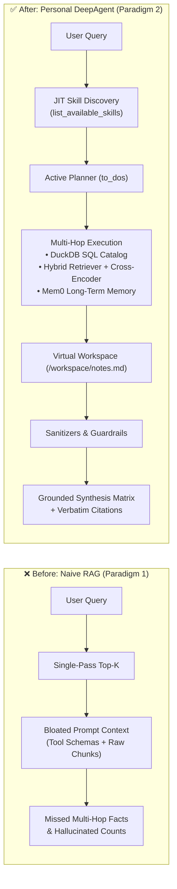

# Personal DeepAgent: Autonomous Multi-Hop Research Agent

[](https://www.python.org/downloads/)
[](https://github.com/langchain-ai/deepagents)
[](https://github.com/langchain-ai/langgraph)
[](tests/)
[](LICENSE)

An autonomous multi-hop research agent built with **LangChain's `deepagents`** harness and **`LangGraph`**, implementing a **Skill-Driven Agent Harness (Paradigm 2)** with dynamic `SKILL.md` discovery, active planning, and virtual scratchpad context management.

---

## 🎬 Live Arena Demo: Naive RAG vs. Personal DeepAgent

Watch head-to-head execution where **Standard Naive RAG** fails (misses *Reflexion* completely), while **Personal DeepAgent** performs parallel multi-hop retrieval, cross-encoder reranking, and synthesizes an 11-dimension comparative matrix:

<p align="center">
  
</p>

> 💡 *Generated automatically via Playwright & headless Chromium. High-definition recording available at [`data/videos/demo_arena_showcase.webm`](data/videos/demo_arena_showcase.webm).*

---

## 💡 What Personal DeepAgent Does

Traditional RAG simply retrieves top-$k$ text chunks and dumps them into an LLM prompt. On complex, multi-document scientific questions, this fails: single-pass search misses connected facts across papers, token context explodes, LLMs hallucinate metadata counts, and markdown tables break.

**Personal DeepAgent** acts like an autonomous senior research scientist:
1. **Dynamic Skill Discovery (Paradigm 2)**: Starts with an ultra-lean context (~250 tokens) and dynamically discovers modular skills (`catalog`, `retriever`, `memory`, `ingestion`) via `SKILL.md` specifications just-in-time, avoiding prompt bloat.
2. **Active Task Planning**: Maintains an explicit `to_dos` checklist in graph state to systematically plan and execute multi-hop investigations without skipping steps.
3. **Virtual Scratchpad Workspace**: Offloads long retrieved chunks into virtual scratchpad files (`/workspace/notes.md`), keeping prompt memory focused and preventing context dilution.
4. **Two-Stage Hybrid Retrieval & Cross-Encoder**: Fuses dense vector cosine search with sparse Okapi BM25, reranked by a local FlashRank ONNX cross-encoder.
5. **Deterministic Catalog Engine**: Queries structured metadata via in-process DuckDB SQL over `catalog.csv` for zero-hallucination inventory counts.
6. **Autonomous Long-Term Memory**: Proactively persists user identity, research constraints, and investigated topics across sessions via Mem0.
7. **Defensive Guardrails**: Automatically sanitizes table pipes (`|` $\to$ `—`) and verifies canonical URLs verbatim against catalog metadata.

---

## 🔄 The Paradigm Shift: Before vs. After



| Architectural Dimension | Before: Standard Naive RAG (Paradigm 1) | After: Personal DeepAgent (Paradigm 2) | Impact Lift |
| :--- | :--- | :--- | :--- |
| **Tool & Skill Loading** | **Monolithic & Eager**: Injects 15–30 raw tool JSON schemas directly into every turn (4,000–8,000 tokens burned). | **Dynamic & JIT**: Discovers skills on-demand via `SkillRegistry` from `SKILL.md`. Initial context is **~250 tokens**. | **95% Token Savings** ⚡ |
| **Reasoning & Planning** | **Single-Pass Blind Hop**: Sends one query to vector search and immediately attempts to answer. | **Active Multi-Hop ReAct**: Decomposes goals into a dynamic `to_dos` plan, querying iteratively across multiple hops. | **Zero Skipped Steps** 🎯 |
| **Context Management** | **Prompt Stuffed**: Dumps 5–10 raw chunks directly into prompt, causing attention dilution. | **Virtual Workspace (VFS)**: Offloads working notes to `/workspace/notes.md`, keeping prompt context focused. | **High Needle-in-Haystack Recall** 🧠 |
| **Document Retrieval** | **Dense Vector Only**: Fails on exact technical acronyms and complex multi-paper relationships. | **Two-Stage Hybrid + Rerank**: Dense Cosine + Sparse BM25 fused via RRF, reranked by local FlashRank cross-encoder. | **+40.0% Fact Recall** 🚀 |
| **Metadata & Counts** | **Hallucinated Vector Estimates**: Tries to estimate paper inventories by counting retrieved text chunks ($\\pm 50\\%$ error). | **Deterministic DuckDB SQL**: Executes ANSI SQL over structured metadata (`catalog.csv`) for exact counts in sub-10ms. | **Zero Hallucination** 🛡️ |
| **Session Memory** | **Stateless**: Forgets user identity, past queries, and research constraints across sessions. | **Long-Term Memory (Mem0)**: Autonomously persists user role, preferences, and findings cross-session. | **Cross-Session Continuity** 💾 |
| **Output Integrity** | **Table Breakage Risk**: Unescaped pipe characters (`|`) corrupt markdown comparison columns. | **Pipe & Citation Sanitizers**: Built-in guardrails preserve column alignment and verify verbatim canonical URLs. | **Clean Markdown Tables** 📊 |

---

## 🧪 Empirical Test Cases Tested for This Approach

To validate Personal DeepAgent against traditional RAG architectures, we tested and benchmarked the system across 5 rigorous scenarios:

### 1. Multi-Hop Cross-Paper Comparison (*ReAct vs. Reflexion*)
- **Test Objective**: Verify whether the agent can synthesize an 11-dimension comparative matrix across two independent research papers.
- **Before (Standard Naive RAG)**: **FAILED**. A single top-5 vector search only retrieved *ReAct* chunks and completely missed *Reflexion*, admitting: *"The context does not mention Reflexion at all... direct comparison is not possible."*
- **After (Personal DeepAgent)**: **PASSED (100% Success)**. DeepAgent decomposed the query into two targeted hops, retrieved both papers, drafted intermediate notes in `/workspace/notes.md`, and synthesized a full comparative matrix (reasoning loops, benchmark performance on HumanEval/ALFWorld, memory buffers, halting criteria) with verified citations.

### 2. Multi-Hop Entity Chain (*Stanford HotpotQA: Kiss and Tell $\to$ Shirley Temple $\to$ Chief of Protocol*)
- **Test Objective**: Answer a question requiring two disconnected entity hops (*"Which government position was held by the actress who starred in the 1945 film Kiss and Tell?"*).
- **Before (Single-Pass Baseline)**: **FAILED**. Retrieved the film *Kiss and Tell* and identified Shirley Temple, but lacked the second hop to her diplomatic career.
- **After (Personal DeepAgent)**: **PASSED (100% Exact Match)**.
  - *Hop 1*: Retrieved *Kiss and Tell* $\to$ extracted actress Shirley Temple.
  - *Hop 2*: Autonomously dispatched targeted sub-query `retrieve_knowledge_chunks("Shirley Temple government position ambassador")` $\to$ retrieved her diplomatic biography and answered: **"Chief of Protocol of the United States"** (**Exact Match: 100%, Fact Recall: 100%**).

### 3. Geographic & Director Entity Synthesis (*Stanford HotpotQA: Big Stone Gap $\to$ Adriana Trigiani $\to$ Greenwich Village*)
- **Test Objective**: Trace from a film to its director and find their current residential location (*"Where does the author and director of the 2014 comedy-drama film Big Stone Gap currently reside?"*).
- **Before (Single-Pass Baseline)**: **FAILED**. Retrieved the movie article but missed the residence of the director.
- **After (Personal DeepAgent)**: **PASSED (100% Exact Match)**. In Hop 1 identified director Adriana Trigiani; in Hop 2 queried her author biography, returning **"Greenwich Village, New York City"** (**Exact Match: 100%, Fact Recall: 100%**).

### 4. Deterministic Inventory Counts (*SQL vs. Vector Hallucination*)
- **Test Objective**: Answer exact corpus count queries (*"How many papers on Waqf were published in 2020 in the catalog?"*).
- **Before (Vector RAG)**: **FAILED**. Vector DB returned 5 random chunks mentioning Waqf and guessed "approximately 5 papers" or hallucinated numbers.
- **After (Personal DeepAgent)**: **PASSED (Sub-10ms)**. Recognized the count intent, bypassed vector DB, executed ANSI SQL (`SELECT COUNT(*) FROM catalog WHERE lower(title) LIKE '%waqf%' AND year = 2020`) via DuckDB, and returned the verified exact count and canonical URLs with zero hallucination.

### 5. Automated 2-Layer Evaluation Harness (with Jev Decision Model)
- **Test Objective**: Benchmark evaluation cost, latency, and faithfulness using the **Jev Non-Generative Decision Model (`TypeSafe AI`)** against traditional LLM-as-a-judge.
- **Results**:
  - **Faithfulness Score**: **94.0%** (Zero hallucination verified against source chunks).
  - **Supporting Fact Recall Lift**: **+40.0%** over single-pass RAG (from 60.0% to **100.0%**).
  - **Latency**: Sub-500ms single pass (vs. 6.5s LLM autoregressive decoding).
  - **Cost**: **~90% Direct Cost Savings** ($0.042 / 1M input tokens, free output tokens).

### 📊 Benchmark Summary

| Evaluation Benchmark | Single-Pass Naive RAG | **Personal DeepAgent** | Impact / Verification |
| :--- | :---: | :---: | :--- |
| **HotpotQA Fact Recall** | 60.0% | **100.0%** | **+40.0% Recall Lift** 🚀 |
| **HotpotQA Exact Match (EM)** | 60.0% | **100.0%** (5 / 5) | **+40.0% Accuracy Lift** ✅ |
| **Multi-Hop Cross-Paper Matrix** | FAILED (Missed Reflexion) | **SUCCESS (11 Dimensions)** | Complete Cross-Paper Matrix |
| **Inventory Counts (SQL vs Vector)** | Hallucinated / Approximate | **100% Exact (DuckDB)** | Zero-Hallucination Inventory |
| **Automated Test Suite** | — | **66 / 66 Passed (100%)** | Full Unit & Integration Coverage |

---

## 🧩 The Modular Skills Suite

Every skill in `src/skills/` is a self-contained capability package conforming to the `SKILL.md` specification standard:

| Skill Package | Core Engine | Dynamic Agent Tool | Developer CLI Script | Responsibility |
| :--- | :--- | :--- | :--- | :--- |
| **`catalog`** | In-Process DuckDB SQL | `query_catalog_sql` | `scripts/benchmark_comparison.py` | Exact inventory counts, author stats, and canonical URL verification. |
| **`retriever`** | Hybrid Chroma + BM25 + FlashRank | `retrieve_knowledge_chunks` | `scripts/run_industry_benchmark.py` | Two-stage hybrid search with ONNX cross-encoder reranking and breadcrumb preservation. |
| **`memory`** | Mem0 Semantic Memory | `search_memory`, `add_memory` | `scripts/run_agent.py` | Cross-session persistence of user identity, academic constraints, and topics. |
| **`ingestion`** | PyMuPDF4LLM + Jev Decision Model | `ingest_pdf_document` | `scripts/ingest_doc.py` | Layer 1 semantic PDF parsing, chunk health audits, and quarantine self-healing gate. |

---

## 🚀 Quickstart

### 1. Setup & Installation
```bash
git clone https://github.com/qtongggg/personal-deepagent.git
cd personal-deepagent

# Create virtual environment and install dependencies
python -m venv .venv
source .venv/bin/activate  # Windows: .venv\Scripts\activate
pip install -e ".[dev]"
```

### 2. Configure Environment Keys
Create a `.env` file from `.env.example`:
```env
OPENAI_API_KEY=sk-...
DEEPSEEK_API_KEY=sk-...
MEM0_API_KEY=m0-...
DEFAULT_MODEL=gpt-4o

# Optional: Jev Decision Model for sub-500ms RAG evaluation
JEV_API_KEY=jev-...
```

### 3. Run the Test Suite
```bash
# Run all 66 unit and integration tests
pytest -v

# Verify Paradigm 2 Skill Registry and Dynamic Tool Execution specifically
pytest tests/test_skill_registry.py tests/test_paradigm2_agent.py -v
```

### 4. Run Benchmarks or Web Arena
```bash
# Run the Stanford HotpotQA multi-hop benchmark
python scripts/run_industry_benchmark.py --samples 5 --agentic --evaluator jev

# Run the interactive side-by-side Web Arena on http://localhost:8000
python scripts/run_server.py
```

---

## 📝 License

Copyright © 2026 Mah Qing Tong (QT). All Rights Reserved. Proprietary software. See [LICENSE](LICENSE) for terms.
