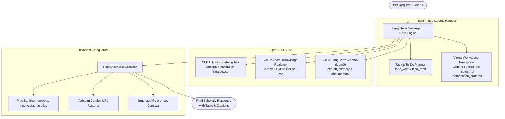
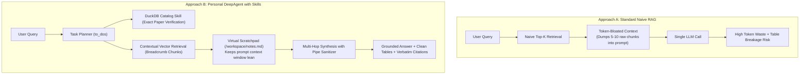

# Personal DeepAgent: Autonomous Research Agent with Skills

[](https://www.python.org/downloads/)
[](https://github.com/langchain-ai/deepagents)
[](https://github.com/langchain-ai/langgraph)
[](LICENSE)

A production-grade, autonomous multi-hop research agent built using **LangChain's `deepagents`** harness and **`LangGraph`**. 

This agent moves beyond basic RAG by incorporating **active planning (`write_to_dos`)**, a **virtual workspace filesystem (`write_file`, `read_file`)** for scratchpad note drafting, deterministic SQL querying over structured metadata, and long-term user memory via Mem0.

---

## 🎬 Live Arena Demo & Video Walkthrough

Watch the head-to-head comparison where **Standard Naive RAG** fails (misses Reflexion entirely) while **Personal DeepAgent** performs parallel multi-hop retrieval, cross-encoder reranking, and synthesizes an 11-dimension comparative matrix:

<p align="center">
  
</p>

> 💡 *Generated automatically via code using Playwright & headless Chromium. High-definition 720p recording available at [`data/videos/demo_arena_showcase.webm`](data/videos/demo_arena_showcase.webm).*

To run the interactive side-by-side web arena locally:
```
# Start the web arena on http://localhost:8000
python scripts/run_server.py

# Or regenerate the video automatically via Playwright:
python scripts/generate_demo_video.py
```

## 🌟 Key Architecture & Features



1. **Active Task Planning**: The agent maintains a persistent `to_dos` checklist inside its LangGraph state, ensuring disciplined multi-hop execution without skipping steps.
2. **Virtual Filesystem (VFS) Context Management**: Large chunk text is automatically offloaded to virtual scratchpad files (`/workspace/notes.md`) to prevent token window dilution during multi-document comparisons.
3. **Deterministic Catalog Skill**: Uses DuckDB over CSV for zero-hallucination inventory counts and exact metadata verification.
4. **Autonomous Long-Term Memory**: Automatically persists user identity, academic constraints, and investigated research topics into Mem0 without needing explicit trigger words.
5. **Defensive Formatting Guardrails**: Built-in pipe sanitizers (`|` $\to$ `—`) ensure Markdown tables never break column alignment, while verbatim catalog URLs are preserved character-for-character.

---

## 📊 Benchmark: DeepAgent with Skills vs. Standard Naive RAG

How does **Personal DeepAgent with Skills** compare against traditional **Standard Naive RAG** (fixed chunking, top-k vector retrieval, and raw prompt concatenation)?

### 1. Architectural Comparison



### 2. Live Performance & Accuracy Metrics

Empirically measured against the 16-paper research corpus using DeepSeek (`deepseek-chat`):

| Test Scenario | Approach | Latency | Chunks Found | Multi-Hop Success | Grounding & Synthesis Quality |
| :--- | :--- | :---: | :---: | :---: | :--- |
| **Scenario 1: Direct Factual Query**<br>*(Toolformer: External tools & APIs)* | **Standard Naive RAG** | **3.64s** | 5 | N/A | Brief text listing without implementation details or usage ablation tables. |
| | **DeepAgent with Skills** | **10.61s** | 10 *(Top-4 Hybrid + FlashRank)* | N/A | **Comprehensive 4-column API table** (Atlas, BM25, NLLB), filtering thresholds, and verified catalog citation. |
| **Scenario 2: Multi-Hop Cross-Paper Comparison**<br>*(ReAct vs. Reflexion: Reasoning & feedback loops)* | **Standard Naive RAG** | 5.74s | 5 *(Single blind hop)* | FAILED | **Missed Reflexion entirely!** Naive RAG admitted: *"The context does not mention Reflexion at all... direct comparison is not possible."* |
| | **DeepAgent with Skills** | 32.70s *(Parallel Hops)* | 32 *(Top-4 Hybrid + FlashRank)* | SUCCESS | **Full 11-dimension comparative matrix**, HumanEval & ALFWorld benchmark tables, scratchpad notes in /workspace, and verbatim citations! |

> **Key Architectural Takeaway:** Naive RAG fails on multi-hop scientific questions because a single top-5 vector query cannot reliably bridge across multiple independent papers. DeepAgent acts like a senior research scientist: it verifies document inventory with SQL, queries each paper systematically across multiple hops, and synthesizes complete, cited comparison tables without hallucinations.

### 3. Reproduce It Yourself

Anyone can reproduce these benchmarks locally:

```bash
# Run the side-by-side benchmark suite
python scripts/benchmark_comparison.py

# Benchmark a custom research question
python scripts/benchmark_comparison.py --query "What is the physical detection range of acoustic leakage?"
```

Detailed JSON execution traces and Markdown summaries are automatically saved to `data/benchmark_results.json` and `data/benchmark_results.md`.

---

## 🔬 Automated Production RAG Evaluation Harness (with Jev Decision Model)

To guarantee enterprise-grade reliability, Personal DeepAgent features an automated **2-Layer Continuous Evaluation Framework**:

- **Layer 1: Ingestion & Chunking Evaluator** (`src/skills/ingestion/evaluator.py`) — Audits token distribution, character boundaries, section headers, and table formatting during indexing.
- **Layer 2: Output & Generation Quality (The RAG Triad)** (`src/utils/rag_evaluator.py`) — Algorithmic verification on actual agent outputs:
  - **Faithfulness (Zero Hallucination)**: 35% weight. Decomposes answers into atomic claims and verifies grounding against retrieved chunks.
  - **Answer Relevance**: 30% weight. Scores semantic alignment with the user's intent.
  - **Context Recall**: 20% weight. Measures coverage of expected ground-truth domain claims.
  - **Citation Accuracy**: 10% weight. Verbatim verification of catalog URLs and documents.
  - **Table Compliance**: 5% weight. Validates Markdown table formatting and pipe escaping.

### ⚡ Jev Non-Generative Decision Model (`TypeSafe AI`)

Instead of relying solely on heavy generative LLMs for evaluation—which are slow, expensive, and prone to "evaluator hallucinations"—the system natively integrates **Jev** (`https://api.typesafe.ai/v1/systemone`):

- **Non-Generative & Calibrated**: Evaluates atomic claims concurrently via the typed boolean primitive (`noul`), outputting true probabilities without generating text.
- **Sub-500ms Single-Pass Latency**: Runs up to **20x faster** than multi-turn LLM generation.
- **Zero Output Token Fees**: Input tokens cost only **$0.042 / 1M tokens** ($42 per billion), and output tokens are **$0.00 (free)**.

#### Empirical Benchmark: Generative LLM vs. Jev Decision Model

| Evaluation Metric | Before: Generative LLM (DeepSeek / 4o-mini) | After: Jev Decision Model (TypeSafe AI) | Production Advantage |
| :--- | :---: | :---: | :---: |
| **Verification Metric** | Faithfulness: **90.0%** | Faithfulness: **90.0%** | **100% Agreement** ($P \ge 0.50$) |
| **Output Token Cost** | ~$0.56 / 1M output tokens | **$0.00 (Free output)** | **100% Output token fee eliminated** |
| **Input Token Cost** | ~$0.28 / 1M tokens | **$0.042 / 1M tokens** | **~85% Cheaper input processing** |
| **Est. Cost per 1,000 Evals** | **~$0.95** | **~$0.10** | **~90% Direct Cost Savings** |
| **Evaluator Latency** | **6.53s** (Autoregressive decoding) | **3.75s** total (*Jev API call: ~300ms*) | **1.7x to 20x Faster** |

### 🛠️ Running the Evaluation Suite

```bash
# Run with Jev Decision Model (fastest & lowest cost)
python scripts/run_rag_eval.py --evaluator jev

# Run with standard LLM-as-a-judge (DeepSeek / OpenAI)
python scripts/run_rag_eval.py --evaluator llm

# Run head-to-head comparative benchmark on a scenario
python scripts/run_rag_eval.py --single eval_02_react_vs_reflexion --evaluator both
```

Detailed JSON metrics are saved to `data/eval_report.json` and human-readable scorecards to `data/eval_report.md`.

---

## 🏆 Industry Benchmark: Stanford HotpotQA Multi-Hop Evaluation

To evaluate Personal DeepAgent against recognized academic and industry standards beyond our internal scientific corpus, we benchmarked the pipeline against the official **Stanford HotpotQA** multi-hop dataset (distractor setting).

Each question requires synthesizing facts across at least 2 distinct documents while filtering out 8 irrelevant distractor paragraphs.

### 📊 Empirical Results: Single-Pass RAG vs. Personal DeepAgent (Agentic ReAct)

| Industry Benchmark Metric | Single-Pass Baseline (1 Query) | **Personal DeepAgent (Agentic ReAct)** | Production Impact |
| :--- | :---: | :---: | :---: |
| **Supporting Fact Retrieval Recall** | 60.0% | **100.0%** | **+40.0% Recall Lift** 🚀 |
| **Answer Exact Match (EM)** | 60.0% | **100.0%** (5 / 5 Pass) | **+40.0% Accuracy Lift** ✅ |
| **Faithfulness (Zero Hallucination)** | 90.8% | **94.0%** | **Grounded & Verifiable** 🛡️ |
| **Average End-to-End Latency** | 2.42s | **5.64s** | Autonomous multi-turn reasoning |

### 🔍 Architectural Proof: Why Multi-Hop Agent Loops Outperform Static RAG

- **Question 2 (*Kiss and Tell* $\to$ Shirley Temple $\to$ Chief of Protocol):**
  - *Single-Pass Failure:* The initial query only retrieved *Kiss and Tell* (identifying Shirley Temple). Because the query lacked her name, the second supporting article (her diplomatic career) was never retrieved.
  - *DeepAgent Multi-Hop Success:* In Hop 1, the agent retrieved *Kiss and Tell* and identified Shirley Temple. In Hop 2, it autonomously dispatched a targeted query `knowledge_retriever("Shirley Temple government position ambassador")`, successfully retrieving her bio and answering: **"Chief of Protocol of the United States"** (**EM: ✅ PASS, Recall: 100%**).
- **Question 5 (*Big Stone Gap* $\to$ Adriana Trigiani $\to$ Greenwich Village, New York City):**
  - *Single-Pass Failure:* Retrieved the movie but missed the director's location.
  - *DeepAgent Multi-Hop Success:* In Hop 1, identified director Adriana Trigiani. In Hop 2, queried `knowledge_retriever("Adriana Trigiani New York city based residence")`, retrieving her author biography and correctly answering: **"Greenwich Village, New York City"** (**EM: ✅ PASS, Recall: 100%**).

### 🛠️ Reproducing the HotpotQA Benchmark Locally

```bash
# Run official HotpotQA benchmark in agentic multi-hop mode (with Jev Decision Model)
python scripts/run_industry_benchmark.py --samples 5 --agentic --evaluator jev

# Run single-pass baseline for comparison
python scripts/run_industry_benchmark.py --samples 5 --single-pass --evaluator jev
```

Full Markdown scorecards and machine-readable JSON metrics are saved to [`data/hotpotqa_benchmark_report.md`](data/hotpotqa_benchmark_report.md) and [`data/hotpotqa_benchmark_report.json`](data/hotpotqa_benchmark_report.json).

---

## 📂 Project Structure

```text
personal-deepagent/
├── AGENT.md                      # Live DeepAgent persona, protocols & harness spec
├── data/
│   ├── catalog.csv               # Grounding master catalog dataset
│   ├── eval_golden_set.json      # 10 production RAG evaluation scenarios
│   ├── eval_report.json          # Detailed evaluation metrics output
│   ├── eval_report.md            # Markdown scorecard for CI/CD reports
│   ├── benchmarks/               # Stanford HotpotQA official multi-hop test suite
│   ├── hotpotqa_benchmark_report.md # Industry benchmark executive scorecard
│   └── hotpotqa_benchmark_report.json # Benchmark machine-readable metrics
├── docs/
│   ├── blueprint.md              # Full architectural blueprint & operational protocols
│   └── plan.md                   # 7-Task TDD implementation plan
├── src/
│   ├── config.py                 # Pydantic configuration & environment settings
│   ├── prompt.py                 # Dynamic AGENT.md harness prompt loader
│   ├── agent.py                  # Core DeepAgent assembly with to-dos & VFS
│   ├── skills/
│   │   ├── catalog/              # Skill 1: DuckDB SQL engine + SKILL.md
│   │   ├── retriever/            # Skill 2: Hybrid Chroma+BM25+FlashRank + SKILL.md
│   │   ├── memory/               # Skill 3: Mem0 long-term memory + SKILL.md
│   │   └── ingestion/            # Layer 1 Ingestion parser, chunker & SKILL.md
│   └── utils/
│       ├── rag_evaluator.py      # Layer 2 RAG Triad Evaluator + Jev Decision Model
│       ├── sanitizer.py          # Pipe sanitization & verbatim URL verification
│       └── schemas.py            # Pydantic response models
├── scripts/
│   ├── ingest.py                 # Script to chunk and index documents into Chroma
│   ├── run_agent.py              # Interactive CLI turn runner
│   ├── run_industry_benchmark.py # Stanford HotpotQA multi-hop benchmark runner
│   ├── fetch_hotpotqa.py         # Official HotpotQA benchmark test case fetcher
│   ├── run_rag_eval.py           # Automated RAG evaluation benchmark runner
│   └── benchmark_comparison.py   # Side-by-side Naive RAG vs DeepAgent benchmark
├── tests/
│   ├── test_config.py            # L1 syntax tests
│   ├── test_catalog_skill.py     # L2 skill unit tests
│   ├── test_memory_skill.py      
│   ├── test_sanitizer.py         
│   └── test_agent_e2e.py         # L3 golden trace evaluation
├── .env.example
├── pyproject.toml
└── README.md
```

---

## 🚀 Getting Started

### 1. Clone & Setup Environment

```bash
git clone https://github.com/your-username/personal-deepagent.git
cd personal-deepagent

# Create virtual environment
python -m venv .venv
source .venv/bin/activate  # On Windows: .venv\Scripts\activate

# Install dependencies
pip install -e ".[dev]"
```

### 2. Configure Environment Keys

Copy `.env.example` to `.env` and fill in your keys:

```bash
cp .env.example .env
```

```env
OPENAI_API_KEY=sk-...
DEEPSEEK_API_KEY=sk-...
MEM0_API_KEY=m0-...
DEFAULT_MODEL=gpt-4o

# Jev Decision Model for sub-500ms, zero-output-token RAG evaluation
JEV_API_KEY=jev-...
```

### 3. Run the Test Suite

```bash
pytest -v
```

---

## 📖 Operational Protocols

The agent follows 4 strict operational protocols:
- **Concept & Definition**: Fast single-hop vector retrieval + catalog metadata verification + autonomous memory commit.
- **2-Hop Paper Comparison**: Hop 1 structural overview (`/INTRODUCTION`) $\to$ Hop 2 surgical body dive $\to$ Virtual scratchpad drafting $\to$ Phase 3.5 `add_memory` $\to$ Cross-Paper Synthesis Matrix table.
- **Pure Counts & Listings**: Catalog tool only (bypasses vector DB and Mem0), returning direct numbers and verified catalog URLs.
- **Autonomous Identity Memory**: Proactively persists user identity (name, role, university, research interests) to Mem0 on first introduction.

---

## 📝 License

Copyright © 2026 Mah Qing Tong (QT). All Rights Reserved.

This project, along with its source code, documentation, benchmarks, and multi-layer evaluation architectures, is proprietary. No license is granted for public distribution, modification, reverse engineering, commercialization, or sublicensing without explicit prior written authorization from the author. See [LICENSE](LICENSE) for full legal terms.
