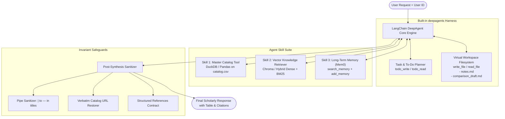

# Personal DeepAgent: Autonomous Research Agent with Skills

[](https://www.python.org/downloads/)
[](https://github.com/langchain-ai/deepagents)
[](https://github.com/langchain-ai/langgraph)
[](https://opensource.org/licenses/MIT)

A production-grade, autonomous multi-hop research agent built using **LangChain's `deepagents`** harness and **`LangGraph`**. 

This agent moves beyond basic RAG by incorporating **active planning (`write_to_dos`)**, a **virtual workspace filesystem (`write_file`, `read_file`)** for scratchpad note drafting, deterministic SQL querying over structured metadata, and long-term user memory via Mem0.

---

## 🌟 Key Architecture & Features



1. **Active Task Planning**: The agent maintains a persistent `to_dos` checklist inside its LangGraph state, ensuring disciplined multi-hop execution without skipping steps.
2. **Virtual Filesystem (VFS) Context Management**: Large chunk text is automatically offloaded to virtual scratchpad files (`/workspace/notes.md`) to prevent token window dilution during multi-document comparisons.
3. **Deterministic Catalog Skill**: Uses DuckDB over CSV for zero-hallucination inventory counts and exact metadata verification.
4. **Autonomous Long-Term Memory**: Automatically persists user identity, academic constraints, and investigated research topics into Mem0 without needing explicit trigger words.
5. **Defensive Formatting Guardrails**: Built-in pipe sanitizers (`|` $\to$ `—`) ensure Markdown tables never break column alignment, while verbatim catalog URLs are preserved character-for-character.

---

## 📂 Project Structure

```text
personal-deepagent/
├── data/
│   └── catalog.csv               # Grounding master catalog dataset
├── docs/
│   ├── blueprint.md              # Full architectural blueprint & operational protocols
│   └── plan.md                   # 7-Task TDD implementation plan
├── src/
│   ├── config.py                 # Pydantic configuration & environment settings
│   ├── prompt.py                 # System prompt with the 4 operational protocols
│   ├── agent.py                  # Core DeepAgent assembly with to-dos & VFS
│   ├── skills/
│   │   ├── catalog_skill.py      # Skill 1: DuckDB deterministic catalog querying
│   │   ├── retriever_skill.py    # Skill 2: Vector chunk RAG with section metadata
│   │   └── memory_skill.py       # Skill 3: Mem0 user memory search & persistence
│   └── utils/
│       ├── sanitizer.py          # Pipe sanitization & verbatim URL verification
│       └── schemas.py            # Pydantic response models
├── scripts/
│   ├── ingest.py                 # Script to chunk and index documents into Chroma
│   └── run_agent.py              # Interactive CLI turn runner
├── tests/
│   ├── test_config.py            # L1 syntax tests
│   ├── test_catalog_skill.py     # L2 skill unit tests
│   ├── test_memory_skill.py      
│   ├── test_sanitizer.py         
│   └── test_agent_e2e.py         # L3 golden trace evaluation
├── .env.example
├── pyproject.toml
└── README.md
```

---

## 🚀 Getting Started

### 1. Clone & Setup Environment

```bash
git clone https://github.com/your-username/personal-deepagent.git
cd personal-deepagent

# Create virtual environment
python -m venv .venv
source .venv/bin/activate  # On Windows: .venv\Scripts\activate

# Install dependencies
pip install -e ".[dev]"
```

### 2. Configure Environment Keys

Copy `.env.example` to `.env` and fill in your keys:

```bash
cp .env.example .env
```

```env
OPENAI_API_KEY=sk-...
MEM0_API_KEY=m0-...
DEFAULT_MODEL=gpt-4o
```

### 3. Run the Test Suite

```bash
pytest -v
```

---

## 📖 Operational Protocols

The agent follows 4 strict operational protocols:
- **Concept & Definition**: Fast single-hop vector retrieval + catalog metadata verification + autonomous memory commit.
- **2-Hop Paper Comparison**: Hop 1 structural overview (`/INTRODUCTION`) $\to$ Hop 2 surgical body dive $\to$ Virtual scratchpad drafting $\to$ Phase 3.5 `add_memory` $\to$ Cross-Paper Synthesis Matrix table.
- **Pure Counts & Listings**: Catalog tool only (bypasses vector DB and Mem0), returning direct numbers and verified catalog URLs.
- **Autonomous Identity Memory**: Proactively persists user identity (name, role, university, research interests) to Mem0 on first introduction.

---

## 📝 License
MIT License. Free to use and adapt for academic and personal research projects.
