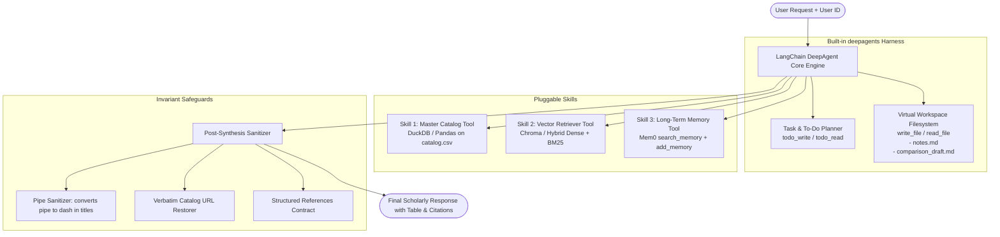

# LangChain DeepAgent (Agent with Skills) Blueprint

> **Focused Blueprint**: Standalone Autonomous Research Agent with Modular Skills using LangChain's **`deepagents`** harness.
>
> **Scope Clarification**: This project implements **strictly the Agent with Skills** (matching the inner autonomous ReAct agent `Agent_memory` / `testing_qt`), without any outer chatflow or complex multi-node routing workflows.

---

## 1. Architectural Overview

Instead of an outer workflow managing routing and nodes, the agent operates as a **single, fully autonomous DeepAgent** equipped with:
1. **Three Core Pluggable Skills**:
   - **Catalog Skill (`catalog_skill`)**: Deterministic querying and exact counts over the master metadata CSV using DuckDB/Pandas.
   - **Vector Knowledge Skill (`retriever_skill`)**: Semantic chunk retrieval over the document knowledge base with full section metadata (`document_name`, `header_path`, `chunk_content`).
   - **Long-Term Memory Skill (`memory_skill`)**: Mem0 integration for user profile personalization (`search_memory`) and autonomous knowledge persistence (`add_memory`).
2. **DeepAgent Harness Built-ins (`deepagents`)**:
   - **Task Planning (`todo_write`, `todo_read`)**: Keeps the agent disciplined across multi-step research.
   - **Virtual Workspace Filesystem (`write_file`, `read_file`)**: The agent drafts section-by-section comparison notes and extracts chunk findings into virtual files (e.g., `workspace/notes.md`) before generating the final synthesis, preventing context window degradation.
   - **Subagent Spawning**: Allows delegating heavy chunk analysis to a child subagent if needed.
3. **Operational Protocols (Prompt Invariants)**:
   - **Protocol 1: Concept & Definition Queries**: Fast single-turn retrieval + catalog metadata verification + autonomous memory commit.
   - **Protocol 2: 2-Hop Comparative Research**:
     - *Hop 1*: Structural probe (retrieve intro chunk `/INTRODUCTION` for thesis & outline).
     - *Hop 2*: Surgical deep dive (3–6 dense keywords targeting body mechanisms).
     - *Sufficiency Gate*: 2–3 substantive chunks per paper.
     - *Phase 3.5*: Mandatory `add_memory` before final answer.
     - *Phase 4*: Single comparative markdown table matrix.
   - **Protocol 3: Pure Counts & Listings**: Catalog skill only (never vector search), verbatim `source_url` printing.
   - **Protocol 4: Autonomous Name & Identity Persistence**: Persists user name, role, and focus to Mem0 immediately on introduction without asking confirmation.
   - **Protocol 5: Safeguard Invariants**: Markdown table pipe sanitization (`|` $\to$ `—`) and verbatim catalog URL preservation.

---

## 2. Architecture & Flow Diagram



---

## 3. Skill & Tool Specifications

### Skill 1: Catalog Skill (`src/skills/catalog_skill.py`)
- **Engine**: In-process DuckDB querying `data/catalog.csv` (871+ entries).
- **Purpose**:
  1. Exact counts ("How many papers on Waqf in 2020?").
  2. Multi-criteria filtering (by author, year, document type).
  3. Mandatory metadata verification for all papers cited in answers.
- **Invariants**:
  - Always search both `title` and `name` using case-insensitive substring matching.
  - Always include verbatim `source_url` for every row.

### Skill 2: Vector Knowledge Skill (`src/skills/retriever_skill.py`)
- **Engine**: ChromaDB / FAISS with dense embeddings (`text-embedding-3-small` or `text-embedding-004`).
- **Purpose**: Content retrieval for concepts, rulings, and deep section bodies.
- **Chunk Metadata Schema**:
  - `document_name`: e.g. `IRP 5`, `IRP 11`
  - `header_path`: e.g. `Introduction > Structure of Sukuk`
  - `chunk_id`: unique chunk identifier
  - `chunk_content`: passage text.

### Skill 3: Long-Term Memory Skill (`src/skills/memory_skill.py`)
- **Engine**: `mem0ai.MemoryClient`.
- **Tools**:
  - `search_memory(user_id: str, query: str)`: Similarity threshold $\ge 0.4$.
  - `add_memory(user_id: str, messages: list)`: Commits user identity, background, and paper comparison topics.
- **Rules**:
  - Strict `user_id` alignment (defaults to `"default_user"` if omitted).
  - Triggers silently when user shares identity (never ask "Would you like me to remember this?").
  - Triggered in Phase 3.5 of paper comparisons.
  - Bypassed entirely for pure count inquiries.

---

## 4. Project Layout

```text
personal-deepagent/
├── .env.example                  # OPENAI_API_KEY, MEM0_API_KEY, etc.
├── pyproject.toml                # Dependencies (deepagents, langgraph, duckdb, chromadb, mem0ai)
├── README.md
├── data/
│   ├── catalog.csv               # Master catalog dataset
│   └── documents/                # Source PDFs/Markdown to ingest
├── src/
│   ├── __init__.py
│   ├── config.py                 # Settings & env parser
│   ├── prompt.py                 # DeepAgent System Prompt (Protocols 1-5)
│   ├── agent.py                  # deepagents.create_deep_agent factory
│   ├── skills/
│   │   ├── __init__.py
│   │   ├── catalog_skill.py      # Skill 1: DuckDB deterministic catalog querying
│   │   ├── retriever_skill.py    # Skill 2: Vector retrieval over chunks
│   │   └── memory_skill.py       # Skill 3: Mem0 search & add memory
│   └── utils/
│       ├── __init__.py
│       ├── sanitizer.py          # Pipe sanitization & verbatim URL verification
│       └── schemas.py            # Pydantic schemas (AgentResponse, ReferenceItem)
├── scripts/
│   ├── ingest.py                 # Ingests documents into Chroma vector store
│   └── run_agent.py              # CLI / Interactive turn runner
└── tests/
    ├── test_catalog_skill.py     # Unit tests for catalog SQL & counts
    ├── test_memory_skill.py      # Unit tests for Mem0 search/add
    ├── test_sanitizer.py         # Unit tests for pipe & URL restoration
    └── test_agent_e2e.py         # End-to-end multi-hop golden trace replay
```

---

## 5. Bootstrap Prompt for the Next Antigravity Session

When you create your new project workspace, copy and paste this prompt directly into Antigravity:

```markdown
Hello Antigravity! 

Please read `outputs/deepagent_project_blueprint.md` and `outputs/deepagent_implementation_plan.md`.
We are building a personal project: an autonomous Research Agent with Skills using LangChain's `deepagents` harness and `LangGraph`.
We are NOT building an outer multi-node workflow—only the autonomous DeepAgent with its 3 skills:
1. `catalog_skill.py`: Exact deterministic queries on `data/catalog.csv` with DuckDB.
2. `retriever_skill.py`: Semantic vector retrieval on document chunks with metadata.
3. `memory_skill.py`: Mem0 integration for user profile personalization & persistence.

The agent uses:
- Built-in planning (`todo_write`, `todo_read`) and virtual workspace files (`write_file`, `read_file`) for intermediate comparative notes.
- System prompt enforcing the 4 Operational Protocols (Concept queries, 2-hop comparison protocol with Phase 3.5 memory commit, count queries, and autonomous name persistence).
- Output sanitizer for table pipe sanitization (`|` -> `—`) and verbatim catalog URLs.

Please implement the tasks in `outputs/deepagent_implementation_plan.md` step-by-step and run tests until all pass!
```
