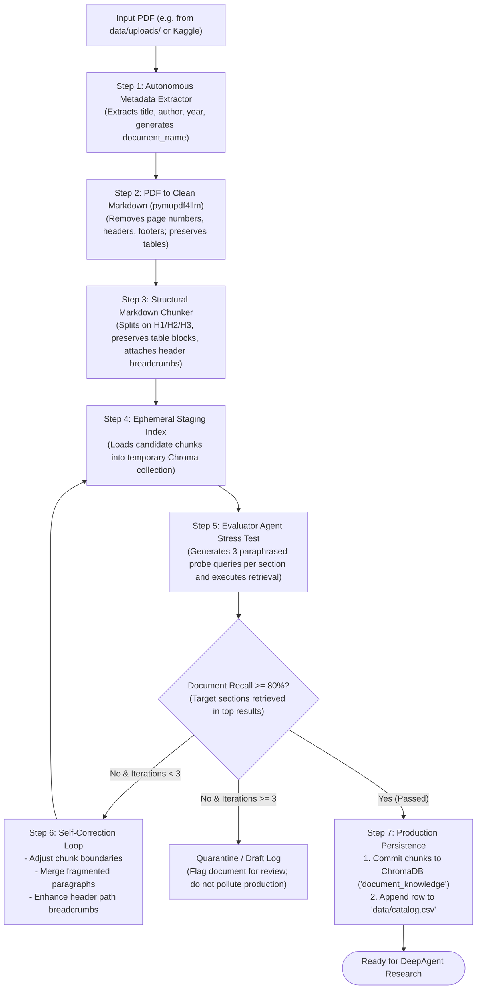

# Design Document: Autonomous Document Ingestion & Agentic Chunking System

## 1. Intent & The Why

Currently, knowledge chunks in `personal-deepagent` are hardcoded manually as a static list in `scripts/ingest.py`. To scale the system to real-world academic research, public datasets (e.g., from Kaggle, arXiv, or institutional repositories), and arbitrary PDF uploads, the system requires an automated **Document Ingestion & Cleaning Pipeline** that:
1. Ingests arbitrary PDF documents (financial, legal, academic, Kaggle datasets) and converts them into clean, structured Markdown.
2. Autonomously extracts document metadata (title, author, year, document type) directly from the document to register new entries in the master catalog.
3. Performs **structural, agentic chunking** that preserves complete section header hierarchies and contextual breadcrumbs.
4. Incorporates a **dedicated Evaluator Agent** that autonomously stress-tests retrieval quality using multi-angle paraphrased probe questions.
5. Self-corrects and adjusts chunk boundaries if retrieval performance is brittle, only committing high-confidence chunks to the ChromaDB vector database and master catalog.

---

## 2. Goals, Non-Goals, and Anti-Goals

### Goals
- **Generic / Multi-Domain PDF Support**: Ingest any standard digital PDF (Islamic finance papers, Kaggle research datasets, corporate annual reports, whitepapers).
- **Autonomous Metadata Extraction (Option A)**: Inspect the document's first page and header to extract `document_name`, `title`, `author`, `year`, and `document_type`, automatically updating `data/catalog.csv`.
- **Noise Elimination**: Strip headers, footers, page numbers, repetitive copyright lines, and irrelevant visual artifacts using `pymupdf4llm`.
- **Context Preservation**: Retain heading hierarchies (`header_path` breadcrumbs, e.g., `# Section > ## Subsection > ### Detail`) attached to chunks to prevent lost-heading amnesia.
- **Multi-Perspective Retrieval Evaluation**: Use the default LLM (`DEFAULT_MODEL`) to generate 3 paraphrased probe questions per section, requiring an aggregated $\ge 80\%$ retrieval recall score.
- **Self-Correction Loop**: Automatically re-tune chunk boundaries (merge split sections, divide oversized blocks, or strengthen heading breadcrumbs) if the retrieval test fails.
- **Production Integrity**: Run non-blockingly; if a document fails after 3 iterations, quarantine it with a diagnostic report rather than corrupting the production index.

### Non-Goals
- Handwriting OCR or complex scanned image de-skewing (focus on digital/text-searchable PDFs).
- Replacing the main DeepAgent research engine (this ingestion system acts as a modular preprocessing tool/skill).

### Anti-Goals
- **Naive Character Chunking**: Blind character-count slicing (`chunk_size=1000`) that breaks tables and detaches paragraphs from headers.
- **Unverified Ingestion**: Committing chunks directly to production without testing their retrieval recall.

---

## 3. Technology Stack & Constraints

- **Python Environment**: Python 3.11+ within the existing `.venv`.
- **Parser**: `pymupdf4llm` for native Markdown conversion with structured table preservation.
- **LLM**: Default model configured in `src/config.py` (with `MockChatModel` support for zero-cost offline unit tests).
- **Vector Storage**: ChromaDB (`.chroma/`), populating collection `document_knowledge`.
- **Metadata Grounding**: `data/catalog.csv` queried via DuckDB.
- **Target Threshold**: $\ge 80\%$ retrieval accuracy across paraphrased probes.

---

## 4. Pipeline Workflow & Architecture



---

## 5. Detailed Component Specifications

### Component 1: Metadata Extractor (`src/skills/ingestion/extractor.py`)
- Reads the first 2 pages of the PDF.
- Uses `DEFAULT_MODEL` with a structured Pydantic schema to extract:
  - `document_name`: Compact slug (e.g., `IRP 45` or `KAGGLE_FIN_2022`).
  - `title`: Full publication title.
  - `author`: Author names or organization.
  - `year`: Publication year (int).
  - `document_type`: Research Paper, Report, Book, Bulletin, or Dataset.
  - `source_url`: Verbatim URL if present, or file path reference.

### Component 2: Parser & Cleaner (`src/skills/ingestion/parser.py`)
- Uses `pymupdf4llm.to_markdown()` to extract semantic Markdown.
- Regex cleaning filters out:
  - Page number patterns (`Page \d+ of \d+`, `\n\d+\n`).
  - Running headers/footers repeated across pages.
  - Isolated decorative characters and broken Unicode ligatures.

### Component 3: Structural Markdown Chunker (`src/skills/ingestion/chunker.py`)
- Splits along Markdown header boundaries (`#`, `##`, `###`).
- Keeps table blocks (`|---|---|`) and bulleted lists intact in a single chunk.
- Attaches the complete hierarchical breadcrumb:
  ```markdown
  [Document: Title | Section: Introduction > Macroprudential Architecture]
  <chunk text body>
  ```
- Assigns unique `chunk_id`: `<document_slug>_chunk_<001..n>`.

### Component 4: Evaluator Agent & Scoring (`src/skills/ingestion/evaluator.py`)
- **Probe Generation**: For each major section, generates 3 semantically distinct test questions (e.g., varying terminology, asking for mechanisms, asking for definitions).
- **Retrieval Test**: Executes test searches against the ephemeral in-memory Chroma collection.
- **Scoring**: A query passes if the retrieved chunk matches the source section's `header_path`.
- **Target**: Document passes if $\ge 80\%$ of all probe queries successfully retrieve their source section.

### Component 5: Self-Correction Loop
- If recall is $< 80\%$, the adjuster:
  1. Identifies which sections failed.
  2. If the section chunk was too short ($< 150$ words), merges it with its sibling/parent.
  3. If the section chunk was too large ($> 800$ words), splits at paragraph boundaries.
  4. Strengthens keyword breadcrumbs in the header path.
- Repeats for up to 3 iterations.

### Component 6: Production Persistence & CLI
- CLI command: `python scripts/ingest_doc.py path/to/document.pdf`
- Also exposed as an agent tool: `ingest_document_tool(file_path: str) -> str`.
- Automatically appends the validated row to `data/catalog.csv` and upserts vectors to ChromaDB collection `document_knowledge`.
